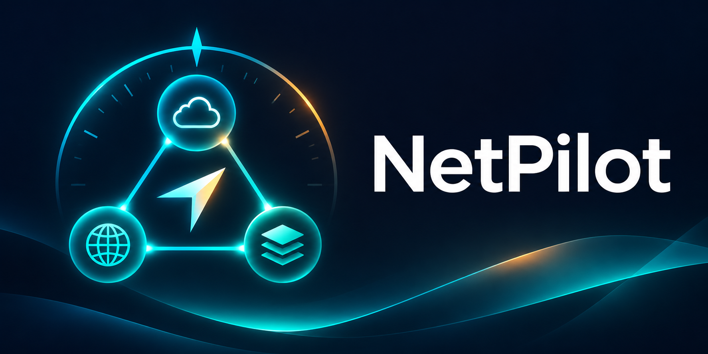

# NetPilot

NetPilot is an iOS and iPadOS app for managing several self-hosted and cloud services from one place.

It brings together tools for:

- Cloudflare account and zone management
- Pi-hole and AdGuard Home DNS monitoring and administration
- Nginx Proxy Manager host management
- n8n workflow access

NetPilot requires iOS or iPadOS 18 or later.

## About this repository

This repository contains public information about NetPilot. The app's source code and development files are kept in a separate private repository. No credentials, private server addresses, or user data belong here.
